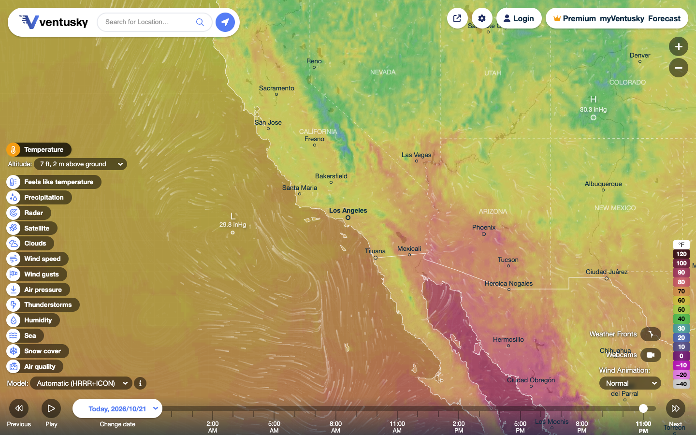
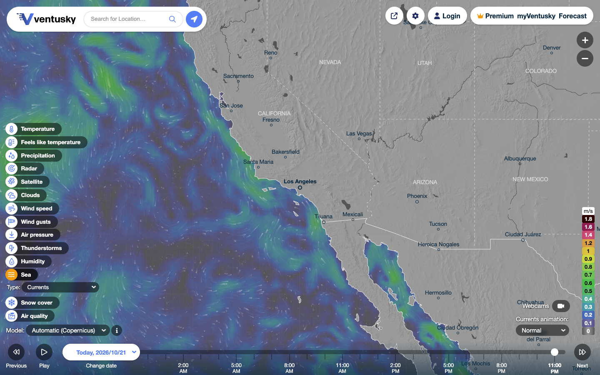
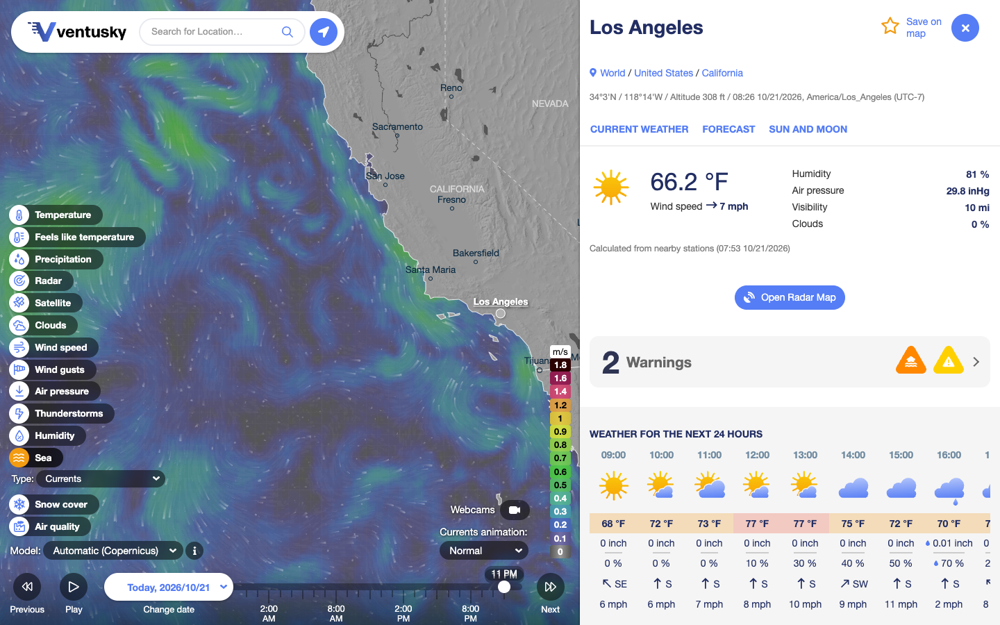

# Ventusky Local

> 个人学习用的 **Ventusky 本地镜像 + 海洋/大气数据接口**。  
> 不是 Ventusky 官方项目，与 Ventusky 没有任何隶属关系。

---

## 0. 先读：范围与声明

这个项目做两件事：

1. **本地镜像**：在本机启动一个反向代理，把 `www.ventusky.com` 的公开网页前端完整地跑在 `http://localhost:8787/`，保留原有地图、图层、模型、时间轴、城市页、搜索、设置等界面。
2. **数据接口**：把网页实际使用的海洋/大气数据接口整理成一套可调用的本地 JSON/图片 API，并附完整目录（41 个模型、88 个界面图层）。

重要限制：

- **仅供个人学习、研究、非商业使用。**
- 天气数据、地图瓦片、图标、网页代码的版权归 Ventusky 及其数据提供方（NOAA、DWD、ECMWF、Copernicus、Météo-France、MET Norway 等）所有。
- 本项目**不复制、不再分发**这些数据；本地镜像只是按浏览器的方式实时请求公开资源。请不要把抓取结果打包发布、转售或用于商业产品。
- **不绕过付费墙。** Premium 图层、更长预报、账号功能仍由 Ventusky 官方账号权限控制；本地代理只做域名改写，不破解、不伪造订阅。
- 使用前请自行确认 Ventusky 的服务条款、robots.txt 和当地法律；批量请求请限速。
- 本地镜像**需要联网**。它不是一个离线天气数据库。

---

## 1. 能做什么

### 1.1 完整公开前端

本地打开后，看到的就是官网的公开界面：



- 左侧 14 个图层组、88 个图层选项（温度、风、降水、雷达、卫星、云、气压、雷暴、湿度、海洋、雪、空气质量等）。
- 高度/类型子菜单（海表、2 m、950–10 hPa、不同波高/周期等）。
- 模型下拉框（ICON、GFS、ECMWF、GEM、ICON-EU、HARMONIE、HRRR、RRFS、NBM、UKMO、ICON-DE/CH/IT、Aladin、AROME、MEPS、RRFS-Hawaii、HARMONIE-CAR）。
- 时间轴、播放、前后翻页、历史日期。
- 地点搜索、点击地图打开城市/坐标页。
- 城市页：当前天气、24 小时、8 天预报、Meteogram、日出日落、预警、附近摄像头、AQI。
- 设置：单位、语言、网格数值、等值线、锋面、火点、摄像头、动画强度等。
- 雷达/卫星的 5/10 分钟级数据。
- 海洋：海温、洋流、潮流、潮位、风暴增水、有效波高、风浪、涌浪、周期。

海洋洋流图层：



点击地图后的城市页：



### 1.2 数据接口

- 41 个模型、88 个图层的机器可读目录。
- 任意模型/图层/时间的整图或分块图片 URL。
- 坐标点 24 小时 + 8 天预报，海上坐标还会带波浪/潮汐图表。
- 高低压中心、锋面、等值线、气旋、火点、摄像头、AQI、地点搜索。
- 历史归档（72 小时以前自动走 `archive.ventusky.com`）。

---

## 2. 快速开始

### 2.1 环境

- Node.js **20+**（在 Node 22.22.2 上测试）。
- 不需要 `npm install`，项目没有第三方运行时依赖。
- 需要能访问 `*.ventusky.com` 的网络。

### 2.2 启动

```bash
cd ventusky-local
npm start
# 或者
node server.mjs
```

看到：

```text
Ventusky Local running at http://127.0.0.1:8787/
API catalog:  http://127.0.0.1:8787/__api/catalog
Health:       http://127.0.0.1:8787/__health
```

打开：

- 本地镜像：<http://localhost:8787/>
- 交互式 API 实验台：<http://localhost:8787/__lab/>
- 目录 JSON：<http://localhost:8787/__api/catalog>
- 健康检查：<http://localhost:8787/__health>

> 推荐用 `localhost`。前端 bundle 只允许 `*.ventusky.com` 和 `localhost` 这类主机名运行，否则会跳转/刷新；反代会把**当前请求的主机名**自动加进白名单，所以 `127.0.0.1`、局域网 IP、反向代理域名，以及 Netlify 的 `*.netlify.app` 都能正常启动。

### 2.3 端口/监听地址

```bash
node server.mjs --port 9000 --host 127.0.0.1
# 或
PORT=9000 node server.mjs
```

默认只监听回环地址，不要直接暴露到公网。

需要看每个瓦片请求时：

```bash
DEBUG_PROXY=1 npm start
```

### 2.4 停止

前台运行时 `Ctrl+C`。后台运行时：

```bash
kill $(cat /tmp/vk-server.pid)
```

---

## 3. 本地镜像使用说明

### 3.1 左侧图层

点击任意图层即可切换。带 `▾` 的图层有子选项，例如：

- **Temperature** → Sea surface / 5 cm / 2 m / Anomaly / 950–10 hPa / Freezing level
- **Precipitation** → 1 h / 3 h / accumulation / monthly anomaly
- **Clouds** → total / fog / low / middle / high / cloud base / visibility
- **Wind speed** → 10 m / 100 m / 250 m / 950–10 hPa
- **Air pressure** → MSL / geopotential 850/500/300 hPa
- **Thunderstorms** → CAPE / CAPE×SHEAR / shear / hail probability / CIN / LI / helicity
- **Sea** → wave height / wind-wave height / wind-wave period / swell / swell period / currents / tidal currents / tide / tide+surge
- **Air quality** → PM2.5 / PM10 / NO₂ / SO₂ / O₃ / dust / CO / AQI / UV

### 3.2 模型

模型下拉框只列出公开可选的大气模型。海洋模型（RTOFS、SMOC、STOFS、MFWAM、WAVEWATCH）不会出现在下拉框里，而是按图层自动选择；这是官网的行为，不是本地镜像的删减。

API 里可以直接指定这些海洋模型，见 [docs/DATA.md](docs/DATA.md)。

### 3.3 时间轴与历史

- 底部时间轴支持拖动、播放、前后翻页。
- “Change date” 可以选历史日期。
- 早于 72 小时的数据自动走 `archive.ventusky.com`。
- 不是所有模型都有完整历史；时间超出范围时图片会 404 或显示占位图。

### 3.4 搜索与城市页

- 顶部搜索框输入城市名，选择结果后地图会跳转。
- 直接点击地图，会打开最近城市/坐标的详情页。
- 坐标页 URL 形式：`/{lat};{lon}`，例如 <http://localhost:8787/35;-140>
- 城市页 URL 形式：`/{slug}`，例如 <http://localhost:8787/los-angeles>

### 3.5 语言与单位

- 语言路径：`/zh`、`/de`、`/cs` 等（例如 <http://localhost:8787/zh>）。
- 单位、网格数值、等值线、锋面、火点、摄像头等设置由原前端保存在浏览器本地；本地代理不修改这些逻辑。
- 设置里的“Show values in grid”会读取瓦片像素并反查色标；它依赖 canvas 同源，本地代理已保证同源。

### 3.6 登录 / Premium / myVentusky

- 页面上的 Login、Premium、myVentusky 链接会经过 `/proxy/my.ventusky.com/...`。
- 登录页能正常打开；但账号 cookie 跨域、支付和安全策略较复杂，**不保证**登录后所有 Premium 功能都能在本地完成。
- 最稳妥的方式：需要账号/付费功能时，直接在官网操作；本地镜像专注于公开图层和数据接口。
- 本项目不会绕过任何付费限制。

### 3.7 已知限制

- 需要联网；没有离线瓦片包。
- 官网改版后，HTML/JS 结构可能变化，代理的 URL 改写规则可能需要更新。
- Cloudflare 可能对高频请求挑战或限流。
- 外部摄像头图片、部分第三方资源可能受其自身 CORS/防盗链限制。
- 分享/嵌入（embed）模式没有专门适配；嵌入页面可能跳回官网说明页。
- 快速连续切换“风/洋流 → 潮汐”等图层时，原前端偶尔会在控制台打印 `Cannot read properties of undefined (reading 'size')`；这是前端动画队列的竞态，目标图层仍会正常显示，刷新页面即可。

---

## 4. 数据接口速览

完整参考见 **[docs/API.md](docs/API.md)**，模型/图层/字段见 **[docs/DATA.md](docs/DATA.md)**。

### 4.1 目录

```bash
curl 'http://localhost:8787/__api/catalog' | jq '.models.icon'
curl 'http://localhost:8787/__api/layers/temperature-2m'
curl 'http://localhost:8787/__api/models/rtofs'
```

### 4.2 时间

```bash
curl 'http://localhost:8787/__api/times?model=hrrr&layer=temperature-2m&limit=6'
```

### 4.3 图片 URL / 图片

```bash
# 只生成 URL
curl 'http://localhost:8787/__api/tile-url?model=icon&layer=temperature-2m&time=2026-10-21T15:00:00Z'

# 直接下载
curl -o temp.jpg 'http://localhost:8787/__api/tile?model=icon&layer=temperature-2m&time=2026-10-21T15:00:00Z'
```

### 4.4 点预报

```bash
curl 'http://localhost:8787/__api/point?lat=35&lon=-140&water=1' | jq '.days[0].slots[0]'
```

### 4.5 海洋图表

```bash
curl 'http://localhost:8787/__api/water?lat=35&lon=-140' | jq '.series.wh.segments[0][:5]'
```

### 4.6 气压/锋面/等值线

```bash
curl 'http://localhost:8787/__api/pressure?model=icon&layer=pressure&time=2026-10-21T15:00:00Z'
curl 'http://localhost:8787/__api/fronts?model=icon&layer=pressure&time=2026-10-21T15:00:00Z'
curl 'http://localhost:8787/__api/isolines?model=icon&layer=pressure&time=2026-10-21T15:00:00Z'
```

### 4.7 其他

```bash
curl 'http://localhost:8787/__api/cyclones'
curl 'http://localhost:8787/__api/fires?z=5&x=5&y=12'
curl 'http://localhost:8787/__api/webcams?lat=34.05&lon=-118.25&count=4'
curl 'http://localhost:8787/__api/aqi?lat=34.05&lon=-118.25'
curl 'http://localhost:8787/__api/search?q=London&lang=en'
```

---

## 5. 海洋数据

### 5.1 图层与模型

| 数据 | 图层 ID | 模型 | 字段 |
|---|---|---|---|
| 海表温度 | `temperature-water` | `rtofs` | `teplota_voda` |
| 洋流 | `currents` | `rtofs`, `smoc` | `proud_u`, `proud_v` |
| 潮流 | `tide-currents` | `smoc` | `tide_proud_u`, `tide_proud_v` |
| 潮位 | `tide` | `stofs`, `stofs_us` | `tide` |
| 潮位+风暴增水 | `tide-surge` | `stofs`, `stofs_us` | `tide_surge` |
| 有效波高 | `wave` | `icon_eu`, `mfwam`, `wavewatch_no`, `icon`(历史) | `swh` + `mdww` |
| 风浪高度 | `wind-wave` | 同上 | `shww` + `mdww` |
| 风浪周期 | `wind-wave-period` | 同上 | `mpww` |
| 涌浪高度 | `swell` | 同上 | `shts` + `mdts` |
| 涌浪周期 | `swell-period` | 同上 | `mpts` |

海浪模型的目录名带 `_water` 后缀，例如 `icon_eu_water`、`mfwam_water`、`wavewatch_no_water`。API 会自动处理，不需要你手写。

### 5.2 海温示例

```bash
curl 'http://localhost:8787/__api/tile-url?model=rtofs&layer=temperature-water&time=2026-10-21T18:00:00Z&zoom=6'
```

返回的 `urls[0]` 类似：

```text
https://data.ventusky.com/2026/10/21/rtofs/tilled_world/hour_18/rtofs_teplota_voda_0_0_20261021_18.jpg?17924544
```

### 5.3 洋流示例

```bash
curl 'http://localhost:8787/__api/tile-url?model=smoc&layer=currents&time=2026-10-21T15:00:00Z&zoom=7'
```

返回两张图：`proud_u` 和 `proud_v`。网页用它们合成箭头/流线；你也可以自己解码 u/v 后计算速度/方向。

### 5.4 海浪示例

```bash
# 有效波高 + 方向
curl 'http://localhost:8787/__api/tile-url?model=icon_eu&layer=wave&time=2026-10-21T15:00:00Z'

# 风浪高度
curl 'http://localhost:8787/__api/tile-url?model=mfwam&layer=wind-wave&time=2026-10-21T15:00:00Z'

# 涌浪周期
curl 'http://localhost:8787/__api/tile-url?model=wavewatch_no&layer=swell-period&time=2026-10-21T15:00:00Z'
```

### 5.5 海上点预报 + 潮汐/波浪图表

```bash
curl 'http://localhost:8787/__api/point?lat=35&lon=-140&water=1' > ocean.json
jq '.days[0].slots[0], .water.series.wh.segments[0][:5]' ocean.json
```

返回的 `water.series`：

- `wh`：有效波高（m）
- `sh`：涌浪高度（m）
- `ti`：潮位（m，MLLW）

原始图表接口是 `chart_water.ajax.php`，带 `days=10`；本地 API 解析了 `data-link` 里的数值。

### 5.6 潮汐注意

- 潮位基准是 **MLLW**（Mean Lower Low Water）。
- `stofs` 是 13 km 全球/区域混合，`stofs_us` 是美国 3 km 高分辨率。
- 潮汐/潮流只在覆盖区域有效；不在覆盖区时图片为空或 404。

---

## 6. 大气数据

### 6.1 温度/风/气压/降水/云

```bash
curl 'http://localhost:8787/__api/tile-url?model=icon&layer=temperature-2m&time=2026-10-21T15:00:00Z'
curl 'http://localhost:8787/__api/tile-url?model=icon&layer=wind-10m&time=2026-10-21T15:00:00Z'
curl 'http://localhost:8787/__api/tile-url?model=icon&layer=pressure&time=2026-10-21T15:00:00Z'
curl 'http://localhost:8787/__api/tile-url?model=hrrr&layer=rain-1h&time=2026-10-21T15:00:00Z'
curl 'http://localhost:8787/__api/tile-url?model=gfs&layer=clouds-total&time=2026-10-21T15:00:00Z'
```

`wind-*`、`currents` 返回多个 URL（u/v）；`rain-3h`、`radar` 可能还有 `auxFields`（降水类型），用 `aux=1` 一并返回。

### 6.2 雷达/卫星

```bash
curl 'http://localhost:8787/__api/tile-url?model=worad_hres&layer=radar&time=2026-10-21T15:15:00Z'
curl 'http://localhost:8787/__api/tile-url?model=goes&layer=satellite&time=2026-10-21T15:00:00Z'
```

- 雷达：5 分钟，文件名 `..._YYYYMMDD_HHmm.jpg`。
- 卫星：10 分钟，分钟作为目录 `.../hour_HH/mm/..._YYYYMMDD_HHmm.jpg`。
- 雷达/卫星都是“分块”更常见；用 `zoom` 或 `tileX/tileY` 触发 `tilled_world`。

### 6.3 空气质量

```bash
curl 'http://localhost:8787/__api/tile-url?model=silam_eu&layer=pm25&time=2026-10-21T15:00:00Z'
curl 'http://localhost:8787/__api/aqi?lat=34.05&lon=-118.25'
```

### 6.4 高低压/锋面/等值线

```bash
curl 'http://localhost:8787/__api/pressure?model=icon&layer=pressure&time=2026-10-21T15:00:00Z'
curl 'http://localhost:8787/__api/fronts?model=icon&layer=pressure&time=2026-10-21T15:00:00Z'
curl 'http://localhost:8787/__api/isolines?model=icon&layer=pressure&time=2026-10-21T15:00:00Z'
```

### 6.5 气旋/火点

```bash
curl 'http://localhost:8787/__api/cyclones'
curl 'http://localhost:8787/__api/fires?z=5&x=5&y=12'
```

---

## 7. 瓦片与时间规则（重点）

### 7.1 URL 模板

```text
https://{data|archive}.ventusky.com/{yyyy}/{MM}/{dd}/{modelDir}/{whole_world|tilled_world}/hour_{HH}{minuteFolder}/{modelDir}_{field}{tilePart}_{yyyyMMdd_HH[mm]}.jpg?{cache}
```

示例：

```text
https://data.ventusky.com/2026/10/21/icon/whole_world/hour_15/icon_teplota_2_m_20261021_15.jpg?17925624
https://data.ventusky.com/2026/10/21/icon/tilled_world/hour_15/icon_teplota_2_m_2_1_20261021_15.jpg?17925624
https://data.ventusky.com/2026/10/21/goes/tilled_world/hour_15/00/goes_rgba_6_7_20261021_1500.jpg?17925948
```

### 7.2 `cache` 参数

`cache` 不是随机数，是模型更新时间（秒）去掉末尾 0。例如 `1792562400` → `17925624`。  
省略它通常也能取到图，但可能命中旧缓存；建议保留。

### 7.3 72 小时归档

- 当前/未来：`data.ventusky.com`
- 早于 72 小时：`archive.ventusky.com`
- API 默认自动选择；`host=archive` 可强制。

### 7.4 分块不是 XYZ

`tilled_world` 是等经纬度大图的固定分块，不是 Web Mercator 的 `{z}/{x}/{y}`。  
`tileX/tileY` 的范围由 `cols/rows` 决定，例如 ICON 是 6×3。

### 7.5 像素 → 经纬度

```text
lon = lon0 + (px + 0.5) / width  * (lon1 - lon0)
lat = lat1 - (py + 0.5) / height * (lat1 - lat0)
```

区域模型（HRRR、ICON-EU、HARMONIE 等）只覆盖 `extent` 指定范围。

### 7.6 图片里没有原始数值

这些 JPG 是已经按色标上色的图片。要拿“某点数值”，用 `/__api/point`；要拿整张网格数值，公开前端没有直接接口，需要从原始数据提供方下载 GRIB 或做像素反查。  
色标反查不是精确科学：JPEG 有压缩、颜色可能重复、透明度会混合。

---

## 8. 逆向过程（使用 REA）

完整的技术笔记（脚本对象、URL 模板、抓包示例、复现步骤）见 **[docs/REVERSE.md](docs/REVERSE.md)**。

本项目按 [morluto/rea](https://github.com/morluto/rea) 的浏览器观察/静态分析流程完成。REA 是一个面向 Agent 的逆向工程工具集，支持 CDP 浏览器观察、脚本 bundle 分析和证据记录。

### 8.1 使用到的 REA 能力

```bash
git clone --depth 1 https://github.com/morluto/rea.git
cd rea
npx -y rea-agents@latest --version   # 6.7.0
```

按照 REA 的文档：

- `docs/browser-observation.md`
- `.agents/skills/reverse-engineer-anything/SKILL.md`
- `docs/javascript-application-workflows.md`

启动带 CDP 的 Brave/Chrome：

```bash
"/Applications/Brave Browser.app/Contents/MacOS/Brave Browser" \
  --headless=new --remote-debugging-port=9222 \
  --user-data-dir=/tmp/rea-vk-profile \
  https://www.ventusky.com/
```

然后用 REA 观察页面：

```bash
npx -y rea-agents@latest list-browser-targets http://127.0.0.1:9222 \
  --allowed-origins https://www.ventusky.com --json

npx -y rea-agents@latest inspect-web-page http://127.0.0.1:9222 <TARGET_ID> \
  --observation-ms 2000 --json

npx -y rea-agents@latest analyze-web-bundle http://127.0.0.1:9222 <TARGET_ID> --json
```

证据保存在：

- [`evidence/rea-targets.json`](evidence/rea-targets.json)
- [`evidence/rea-inspect.json`](evidence/rea-inspect.json)
- [`evidence/rea-bundle.json`](evidence/rea-bundle.json)
- [`evidence/network-sweep.json`](evidence/network-sweep.json) — 逐图层切换时抓到的真实 `data.ventusky.com` 请求

> `inspect-web-page` 的结果受 REA 的 policy filter 影响，部分脚本/正文被过滤；它仍然提供了页面、网络和 DOM 的结构化证据。`analyze-web-bundle` 只静态分析了内联 `MapOptions`（约 8 KB），外部主脚本没有进入它的分析范围。因此，实际接口枚举主要依靠“下载主脚本 + 静态搜索 + 真实浏览器网络抓包”三条证据链交叉验证。

### 8.2 证据链

1. **内联配置**：`https://www.ventusky.com/` 的 `<script>` 里有 `MapOptions`，包含：
   - `root`、`lang`、`lat`、`lon`、`zoom`、`model`、`now`
   - 每个模型的 `TimelineStart`、`TimelineEnd`、`Updated`、`AccumulationStart`
   - `hurricanesUpdated`、`firesUpdated`、`camTilesUpdated`
2. **主脚本**：`https://static.ventusky.com/media/script-en.js?1791624780`（约 377 KB）。
   - `T`：41 个模型及其图层、分辨率、时间步长、更新时间。
   - `wa`：14 个图层组、88 个图层选项、字段名。
   - `Va`：风/洋流/海浪的 u/v、height/direction 字段。
   - URL 模板：`data.ventusky.com`、`archive.ventusky.com`、`map.ventusky.com`。
3. **真实网络抓包**：用 Playwright 驱动 Brave，逐个切换图层/子选项，记录实际请求。
   - 例：`icon_teplota_2_m_20261021_15.jpg?17925624`
   - 例：`smoc_proud_u_1_2_20261021_15.jpg?17925408`
   - 例：`worad_hres_srazky_dbz_2_3_20261021_1515.jpg?17926008`
   - 例：`goes_rgba_6_7_20261021_1500.jpg?17925948`
4. **点预报**：点击地图会请求 `https://www.ventusky.com/{lat};{lon}?ajax`，返回带 `custom-forecast`、`forecast_24`、`data-water` 的 HTML 片段。
5. **辅助接口**：`ventusky_mesta.php`、`ventusky_location.json.php`、`webcams.ventusky.com`、`chart_water.ajax.php`、`chart_aqi.ajax.php`。

### 8.3 没有逆向/没有绕过的部分

- **Premium 付费图层和更长预报**：服务端按账号权限控制，本项目不破解。
- **支付、账号密码、第三方登录**：不做任何绕过；登录页只是普通反向代理。
- **移动 App 私有 API、原始 GRIB/NetCDF 数据**：不在本次网页逆向范围内。
- **广告/统计/第三方追踪**：不分析、不复制。
- **分享/嵌入模式的特殊跳转**：未专门适配。

这不是“放弃功能”，而是明确边界：公开网页能做的都保留；需要账号/付费/私有协议的部分不做绕过。

---

## 9. 项目结构

```text
ventusky-local/
├── server.mjs              # HTTP 代理 + 路由
├── lib/
│   ├── rewrite.mjs         # Ventusky URL/主机名改写
│   ├── api.mjs             # 本地数据 API
│   ├── tiles.mjs           # 模型/图层目录、瓦片 URL 生成
│   ├── forecast.mjs        # 点预报/海洋图表 HTML 解析
│   └── upstream.mjs        # 上游 fetch、HTML 解码
├── data/
│   ├── catalog.json        # 41 模型 / 88 图层 / 字段/时间/栅格元数据
│   └── model-layer-matrix.csv  # 570 条模型×图层组合
├── docs/
│   ├── API.md              # 完整接口参考
│   ├── DATA.md             # 模型/图层/字段/底图总表
│   ├── REVERSE.md          # 逆向笔记与证据链
│   └── screenshots/        # 本地运行截图
├── evidence/               # REA 观察证据
├── public/
│   └── lab.html            # 交互式 API 实验台
├── package.json
└── README.md
```

---

## 10. 常见问题

### Q1. 页面空白 / 没有样式 / 一直刷新

- 确认用 `http://localhost:8787/` 或 `http://127.0.0.1:8787/`。
- 硬刷新（Cmd/Ctrl+Shift+R）。
- 看终端是否有 502/403。Cloudflare 可能临时挑战。
- 如果官网改版导致 JS 结构变化，需要更新 `lib/rewrite.mjs` 的主机名/路径规则。

### Q2. 图片 404

- 时间不在模型有效范围内。
- 模型不支持该图层（先查 `/__api/layers/{id}` 的 `models`）。
- 区域模型不覆盖该经纬度。
- 历史数据没有归档。
- 返回 955 字节 PNG 通常是占位图。

### Q3. 点预报里 `days` 为什么从明天开始？

Ventusky 的 `custom-forecast` 固定从明天开始（`d_1`），当天数据在 `hourly24` 里。  
`hourly24` 有 25 列：当前小时到明天同一小时。

### Q4. 海上点预报没有 `water`

- 该坐标没有海洋图表数据（例如远离覆盖区）。
- 用 `?water=1` 且确认页面里有 `data-water`。
- 可以先调 `/__api/water?lat=&lon=` 单独检查。

### Q5. 为什么图片不是原始数值？

官网地图给浏览器的是上色 JPG，不是 GRIB。原始数值只在服务端/数据提供方。  
点预报是服务端算好的数值；整张网格需要自己从 NOAA/DWD/ECMWF/Copernicus 下载原始数据。

### Q6. 能离线用吗？

不能。项目是本地代理，不是离线数据包。你可以自己缓存图片，但请遵守 Ventusky 的条款，不要重新分发。

### Q7. 能登录/看 Premium 吗？

登录页可以打开，但账号 cookie、支付、订阅校验都在官方域。  
本项目不破解付费墙；需要 Premium 请直接在官网使用。

### Q8. 请求频率多少合适？

建议单 IP 并发 ≤ 4，图片请求间隔 ≥ 100 ms；批量任务加本地缓存。  
不要把本项目暴露到公网，也不要用它做大规模爬取。

### Q9. 为什么 `tileX/tileY` 和 Leaflet 的 XYZ 不一样？

因为 `tilled_world` 是等经纬度大图的固定分块，不是 Web Mercator 瓦片。  
正确用法：先按 `extent`/`width`/`height` 算出像素，再除以 `tileWidth/tileHeight`。

### Q10. 如何更新目录？

官网更新后，重新抓取首页的 `MapOptions` 和 `script-en.js`，重新生成 `data/catalog.json`。  
本项目已经附带 2026-10-21 的目录；短期内外推字段不会大变。

---

## 11. 免责声明

本项目仅用于个人学习、研究和互操作性验证，不提供任何天气预警/航行/航空/灾害决策保证。  
天气数据存在误差，请以官方气象部门和 Ventusky 官网为准。  
因使用本项目产生的任何后果由使用者自行承担。  
如果 Ventusky 或数据提供方要求停止相关行为，请立即停止并删除本地缓存。
